<p align="center">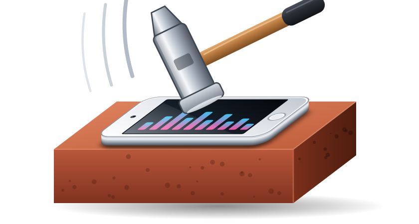</p>

<h1 align="center">AmpEQ</h1>
<p align="center"><b>Real headphone gain, a system-wide 12-band EQ and 8,853 headphone corrections for the iPod touch 7.</b></p>

AmpEQ runs inside iOS's own audio service, so it applies to everything the iPod plays - no special player needed.

## Screenshots

<sub>Swipe / scroll sideways →</sub>

<table><tr>
<td align="center">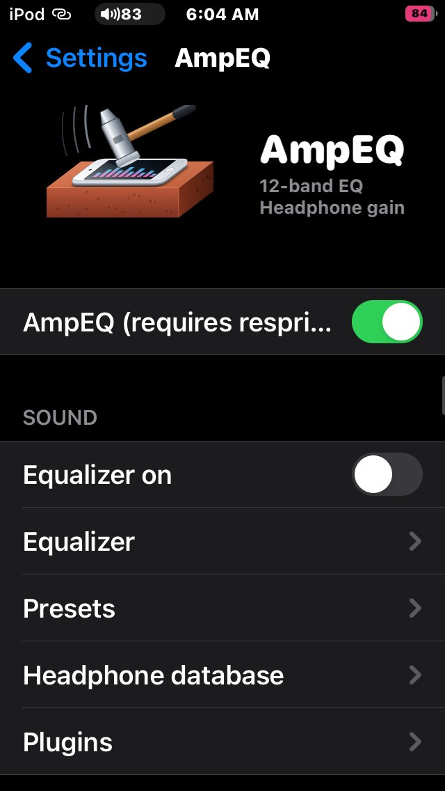<br><sub>Main page</sub></td>
<td align="center">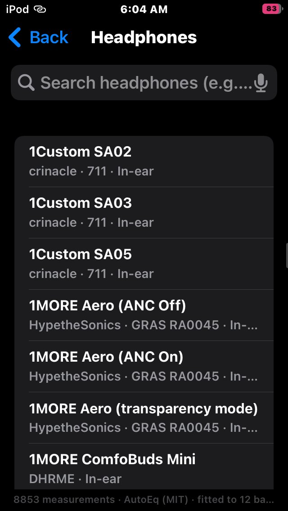<br><sub>Equalizer</sub></td>
<td align="center">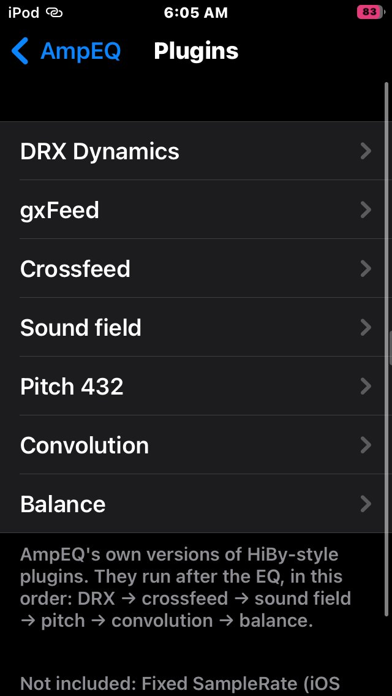<br><sub>Headphone database</sub></td>
<td align="center">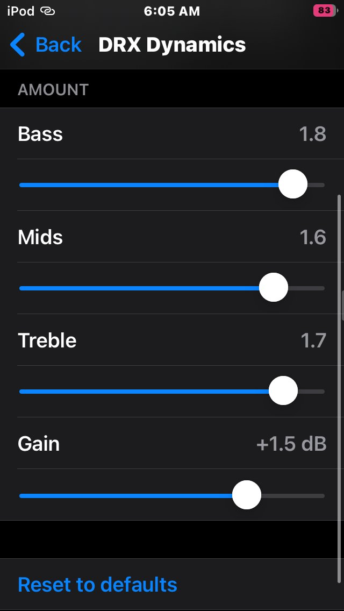<br><sub>Plugins</sub></td>
<td align="center">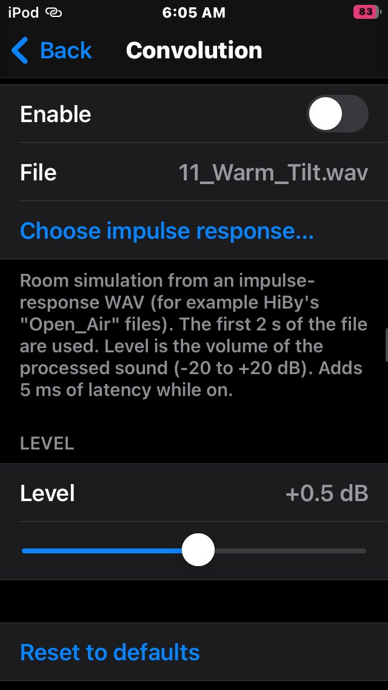<br><sub>DRX Dynamics</sub></td>
<td align="center">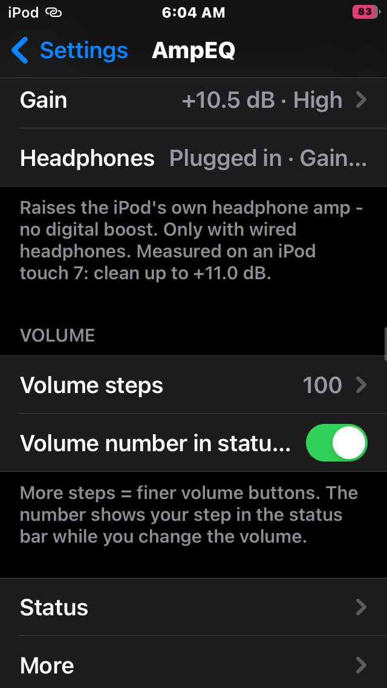<br><sub>Convolution</sub></td>
<td align="center">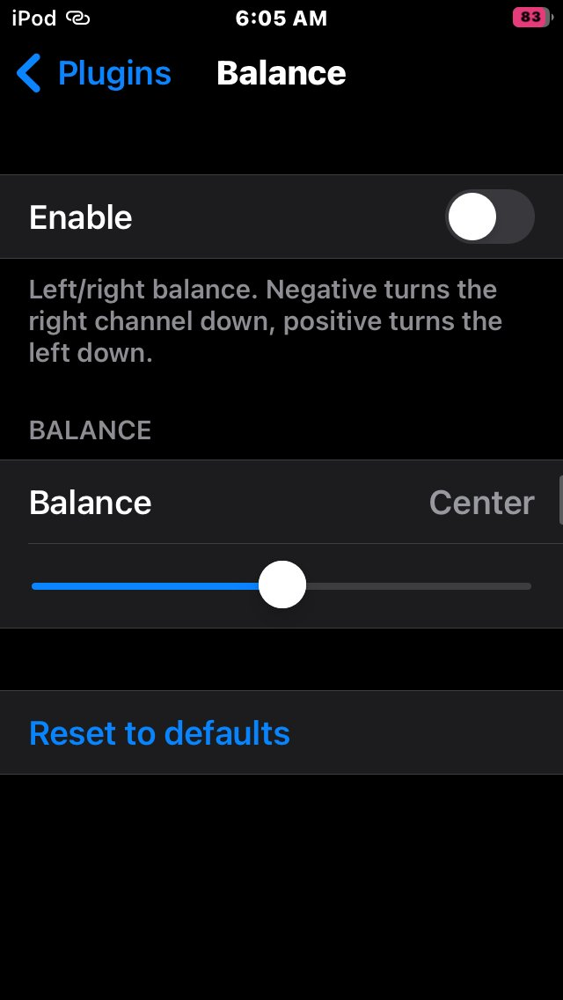<br><sub>Balance</sub></td>
<td align="center">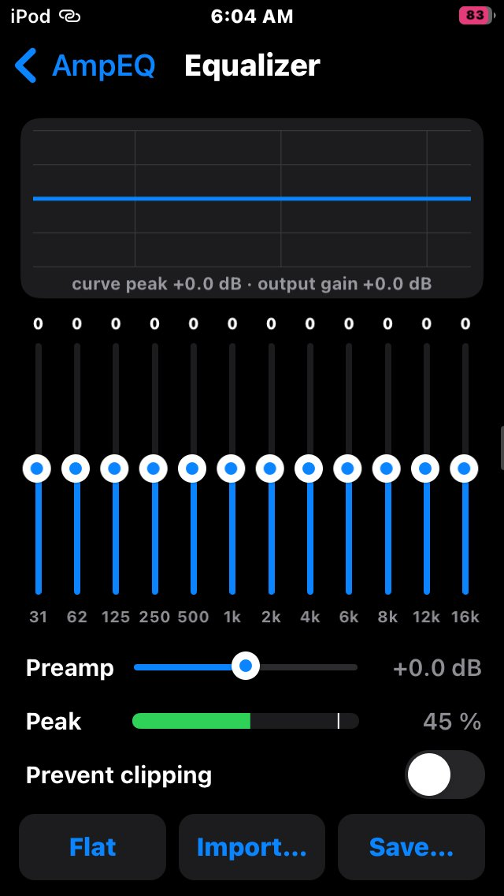<br><sub>Gain & volume</sub></td>
<td align="center">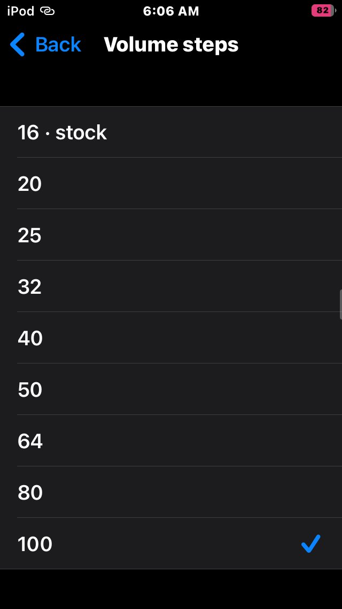<br><sub>Volume steps</sub></td>
<td align="center">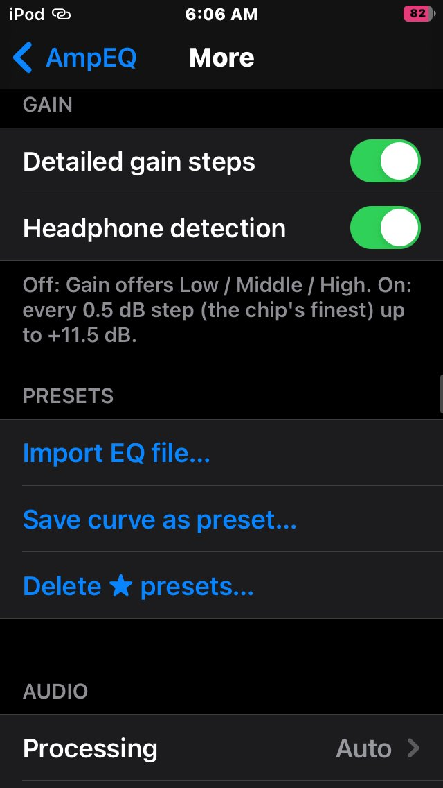<br><sub>More</sub></td>
</tr></table>

## Features

**Gain - real hardware, no digital boost**
Turns up the iPod's own headphone amplifier past Apple's limit. Measured on an iPod touch 7 with a loopback recording (1 kHz):

| | |
|---|---|
| Step size | exactly 0.50 dB |
| Distortion | 0.001 - 0.003 % up to the amp's limit |
| Clean up to | +11.0 dB over stock (Gain + song peak) |

Low (stock) · Middle (+5.5 dB) · High (+10.5 dB), or every 0.5 dB step up to +11.5 dB. Works at every volume step, only with wired headphones.

**12-band equalizer** - 31 Hz to 16 kHz, live curve, presets, import of AutoEq / Equalizer APO GraphicEQ and ParametricEQ files. EQ boosts can't clip.

**Headphone database** - 8,853 corrections from [AutoEq](https://github.com/jaakkopasanen/AutoEq) (oratory1990, crinacle, Rtings...). Search, tap Apply.

**Clip meter + Prevent clipping** - Peace-style peak meter that knows the amp's real limit, and protection that lowers the level 0.5 dB at a time while anything clips.

**Plugins** - DRX Dynamics, gxFeed, Crossfeed, Sound field, Pitch 432, Convolution (impulse-response WAV), Balance.

**Hearing (Accessibility)** - separate left / right ears: each ear gets its own level and 12-band EQ on top of the main Equalizer, for a hearing difference between ears.

**Volume steps** - 16 (stock) to 100 button steps with the stock volume bar, plus an optional step number in the status bar.

## Compatibility

| | |
|---|---|
| Device | iPod touch 7 (iPod9,1) only - the only iPod that runs iOS 15 |
| iOS | 15.0 - 15.8.8 (tested on 15.8.6) |
| Jailbreak | any **rootless** jailbreak: Dopamine or palera1n (rootless). Dopamine is not required. Rootful palera1n is not supported. |
| Needs | ElleKit (or Substrate), PreferenceLoader |

On other iOS 15 devices Gain is locked off for safety (it writes to the iPod's audio chip); everything else is untested and unsupported there.

## Install

Download the `.deb` from [Releases](../../releases) and open it in Sileo or Filza, then respring.

Or from a Mac over USB (`brew install libimobiledevice`, then keep `iproxy 2222 22` running):

```sh
bash mac/Install_On_iPod.command          # installs the .deb in packages/
bash mac/Install_On_iPod.command --build  # builds from source first
```

## Build

Needs [Theos](https://theos.dev) at `~/theos`.

```sh
make clean && make package FINALPACKAGE=1   # -> packages/com.devthedev.ampeq_*.deb
# or: bash mac/Build_Deb.command             # -> copies the .deb to ~/Downloads
```

## Turn off / uninstall

Settings > AmpEQ > switch at the top + respring, or remove **AmpEQ** in Sileo.

## Credits

- Headphone data: [AutoEq](https://github.com/jaakkopasanen/AutoEq) by Jaakko Pasanen (MIT).
- Clip meter idea: Peace Equalizer. Plugin ideas: HiBy Music (HiBy's code is closed; these are AmpEQ's own implementations).

## License

MIT - see [LICENSE](LICENSE).
